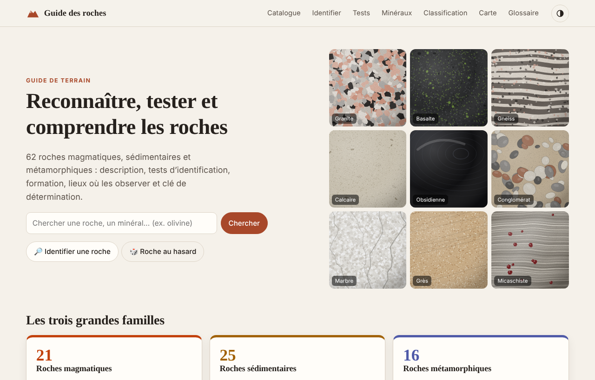
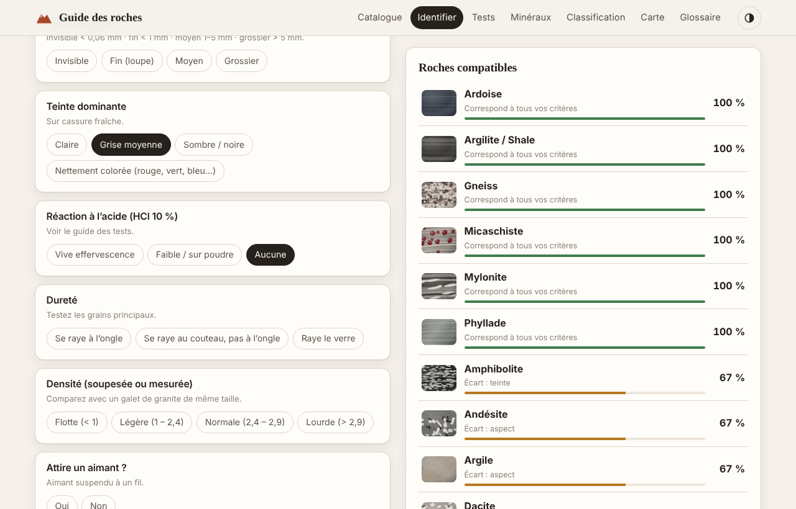

# 🪨 Lithos — Guide des roches

**👉 Ouvrir le guide : https://bridgenzo.github.io/Lithos/**

Guide de terrain **complet et hors-ligne** pour reconnaître, tester et comprendre les roches : 62 fiches illustrées (magmatiques, sédimentaires, métamorphiques), un assistant d'identification, une clé de détermination, le guide des tests, la classification et une carte des localités remarquables.

Site 100 % statique (HTML/CSS/JS, sans framework ni étape de build) : il suffit de l'héberger sur GitHub Pages ou d'ouvrir `index.html`.



## Fonctionnalités

| | |
|---|---|
| 📚 **Catalogue** | 62 roches, recherche plein texte (nom, minéral, lieu, couleur…), filtres par famille et sous-famille, tri par densité/dureté. |
| 🧾 **Fiches détaillées** | Photo (Wikimedia Commons), illustration de la texture, carte d'identité (grain, densité, dureté, acide, magnétisme), composition minéralogique, description, **tests d'identification** (liste à cocher), **roches à ne pas confondre** et comment les distinguer, **formation** et contexte géologique, **lieux où l'observer** (mini-carte), usages, anecdote, liens. Fiches imprimables. |
| 🔎 **Assistant multicritère** | Vous indiquez ce que vous observez (aspect, grain, teinte, acide, dureté, densité, aimant, structure) : les roches compatibles sont classées en direct avec un score et les critères en désaccord. |
| 🗝️ **Clé de détermination** | Une question à la fois jusqu'au nom de la roche ; les 62 roches sont atteignables. |
| 🧪 **Guide des tests** | Observation, dureté de Mohs, acide chlorhydrique, densité (avec **calculateur** par pesée hydrostatique), aimant, trait, sens, eau, cassure, indices de terrain, kit du géologue. |
| 💎 **Minéraux** | Tableau des ~20 minéraux des roches (couleur, dureté, éclat, clivage, indice clé) relié aux fiches. |
| 🧭 **Classification** | Tableau des roches magmatiques (silice × refroidissement), roches sédimentaires (origine, granulométrie), séries métamorphiques et diagramme pression-température des faciès. |
| 🗺️ **Carte** | ~175 localités dans le monde (dont beaucoup en France), filtrables par famille. |
| ★ **Ma collection** | Marquez les roches que vous possédez (enregistré dans le navigateur). |
| 🌓 Thème clair/sombre, mobile, impression | |



## Publier sur GitHub Pages

1. Créez un dépôt sur GitHub et envoyez-y le contenu de ce dossier :
   ```bash
   git init
   git add .
   git commit -m "Guide des roches"
   git branch -M main
   git remote add origin https://github.com/<votre-compte>/Lithos.git
   git push -u origin main
   ```
2. Sur GitHub : **Settings → Pages → Build and deployment → Source : « Deploy from a branch »**, branche `main`, dossier `/ (root)`.
3. Le site est en ligne après une minute à l'adresse `https://<votre-compte>.github.io/Lithos/`.

En local, ouvrez simplement `index.html` dans un navigateur (ou lancez `python3 -m http.server` dans le dossier).

## Installer sur son téléphone

Le guide est une application web installable (PWA) : icône sur l'écran d'accueil, ouverture en plein écran, et **fonctionnement hors ligne** (les fiches, l'identification et les tests sont mis en cache ; les photos et les fonds de carte déjà consultés aussi).

- **iPhone / iPad** : ouvrir le site dans **Safari** → bouton **Partager** → **Sur l'écran d'accueil**.
- **Android** : ouvrir le site dans **Chrome** → bouton **Installer** en haut de la page, ou menu ⋮ → **Installer l'application**.

Après une modification du site, incrémentez `VERSION` dans `sw.js` pour que les téléphones récupèrent la nouvelle version.

## Photos

Les photos sont chargées à la volée depuis l'API de Wikipédia (image principale de l'article, hébergée sur Wikimedia Commons) puis mises en cache 14 jours dans le navigateur. Sous chaque photo, un lien mène à la page du fichier avec **son auteur et sa licence**. Sans connexion, une illustration générée de la texture s'affiche à la place. On peut désactiver les photos depuis le pied de page.

L'image principale d'un article n'est pas toujours un échantillon (parfois un paysage). Pour utiliser **vos propres photos** :

1. déposez l'image dans `images/` (ex. `images/granite.jpg`) ;
2. ajoutez `photo: 'images/granite.jpg',` dans la fiche correspondante.

## Structure

```
index.html              page unique (routeur par #hash)
manifest.webmanifest    déclaration de l'application installable
sw.js                   service worker (hors ligne)
icons/                  icônes de l'application
css/style.css           styles (thème clair/sombre, impression)
js/app.js               application : vues, recherche, identification, cartes
js/texture.js           générateur d'illustrations SVG des textures
js/data/
  magmatiques.js        21 roches
  sedimentaires.js      25 roches
  metamorphiques.js     16 roches
  reference.js          clé de détermination, tests, minéraux, glossaire
vendor/leaflet/         Leaflet 1.9.4 (cartes), inclus pour fonctionner hors CDN
images/                 vos photos (optionnel)
```

## Ajouter ou corriger une roche

Chaque roche est un objet JavaScript dans `js/data/*.js`. Le schéma complet est documenté en tête de `js/data/magmatiques.js`. Les champs `aspect`, `grain`, `teinte`, `hcl`, `durete`, `densite`, `magn` et `struct` alimentent l'assistant d'identification ; `lieux` alimente les cartes (`[nom, pays, latitude, longitude]`) ; `tex` règle l'illustration générée.

Pour qu'une nouvelle roche soit aussi proposée par la clé de détermination, ajoutez une réponse menant à `'r:<id>'` dans `window.CLE` (`js/data/reference.js`).

## Avertissements

- Les valeurs de densité et de dureté sont des **ordres de grandeur** pour la roche entière ; la dureté de Mohs s'applique en toute rigueur aux minéraux.
- L'acide chlorhydrique est corrosif : lunettes et gants, dilution en versant l'acide dans l'eau.
- Respectez la réglementation des sites (réserves naturelles géologiques, propriétés privées) : de nombreux lieux cités interdisent les prélèvements.
- Les coordonnées des localités sont approximatives et servent à situer les sites.

## Licences

- Code : [MIT](LICENSE)
- Textes des fiches : [CC BY-SA 4.0](https://creativecommons.org/licenses/by-sa/4.0/deed.fr)
- Photos : Wikimedia Commons, licence propre à chaque fichier
- Fonds de carte : © contributeurs [OpenStreetMap](https://www.openstreetmap.org/copyright)
- [Leaflet](https://leafletjs.com) : BSD-2-Clause
